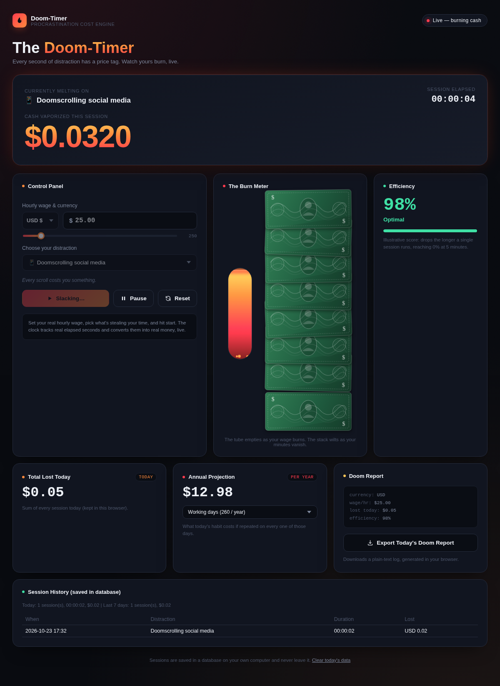

# Doom-Timer

**Real-time distraction cost tracking web application**

Every second of distraction has a price tag. Enter your hourly wage, pick what is stealing your time, and watch the money burn live.

> B.Tech (Computer Science and Engineering) mini project, Pranveer Singh Institute of Technology, Kanpur.



## Features

- Live cost counter: `cost = elapsed hours x hourly wage`, refreshed every 100 ms
- Burn meter, efficiency score, daily total and annual projection (working days or every day)
- Milestone messages that are scaled to the selected currency
- Multiple currencies and distraction types, with start, pause and reset
- **Session history** saved in a SQLite database through a Node.js REST API
- Today's total, last 7 days and recent sessions
- Downloadable plain-text "Doom Report"
- The timer keeps working even if the backend is not running

## Tech stack

| Part | Technology |
|------|------------|
| Front end | HTML5, CSS3, JavaScript (no libraries) |
| Backend | Node.js (built-in `http` module) |
| Database | SQLite (built-in `node:sqlite` module) |
| Browser storage | `localStorage` for today's totals and settings |

## Run it on your computer (localhost)

1. Install [Node.js](https://nodejs.org) **version 22.13 or newer**. Check with `node -v`.
2. Download or clone this repository:
   ```bash
   git clone https://github.com/divyanshuvishwashi/doom-timer.git
   cd doom-timer
   ```
3. Start the server:
   ```bash
   node server.js
   ```
4. Open **http://localhost:3000** in your browser.

No `npm install` is needed. The database file `doomtimer.db` is created automatically on first run. To use a different port on Windows PowerShell: `$env:PORT=4000; node server.js` (on Mac/Linux: `PORT=4000 node server.js`).

## Project structure

```
doom-timer/
├── server.js              Backend: web server + REST API + SQLite
├── public/
│   └── index.html         Front end (the Doom-Timer page)
├── .github/workflows/
│   └── pages.yml          Publishes public/ to GitHub Pages
├── package.json
├── .gitignore
└── README.md
```

## API

| Method | URL | What it does |
|--------|-----|--------------|
| POST | `/api/sessions` | Validate and save a finished session |
| GET | `/api/history` | Today's total, last 7 days total and the 10 most recent sessions |
| DELETE | `/api/sessions` | Clear all saved sessions |

The server calculates the cost itself from the duration and the wage, so saved values cannot be faked by the browser.

### Database table: `sessions`

| Column | Type | Description |
|--------|------|-------------|
| id | INTEGER (PK) | Auto-increment id |
| created_at | TEXT | Local date and time saved |
| distraction | TEXT | What the user was distracted by |
| wage | REAL | Hourly wage used |
| currency | TEXT | Currency code (INR, USD, ...) |
| duration_ms | INTEGER | Session length in milliseconds |
| cost | REAL | Money lost |

## Public demo (GitHub Pages)

GitHub Pages can only host static files, so the public demo at
`https://YOUR-USERNAME.github.io/doom-timer/` runs the **timer and all visuals**, but the **session history needs the Node.js backend** and is only available when you run the project locally.

## Future scope

- Browser extension that starts the timer automatically on distracting websites
- Charts of time lost per distraction
- Focus mode that shows money saved instead of lost
- User accounts with cloud sync, and weekly summary reports

## Author

**Divyanshu Vishwash** (Roll No: 2501640100369)
Under the supervision of **Mr. Yash Sinha** (Assistant Professor)
Pranveer Singh Institute of Technology, Kanpur
